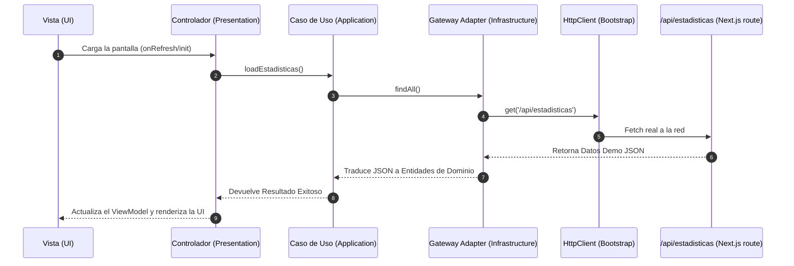

El Flujo de Ejecución en Tiempo de Ejecución (Runtime)

Cuando un usuario entra a la pantalla `/estadisticas`, el viaje que hace el dato es justo el inverso (desde la interfaz hacia la infraestructura y la red):

### En resumen, tu conclusión es brillante: